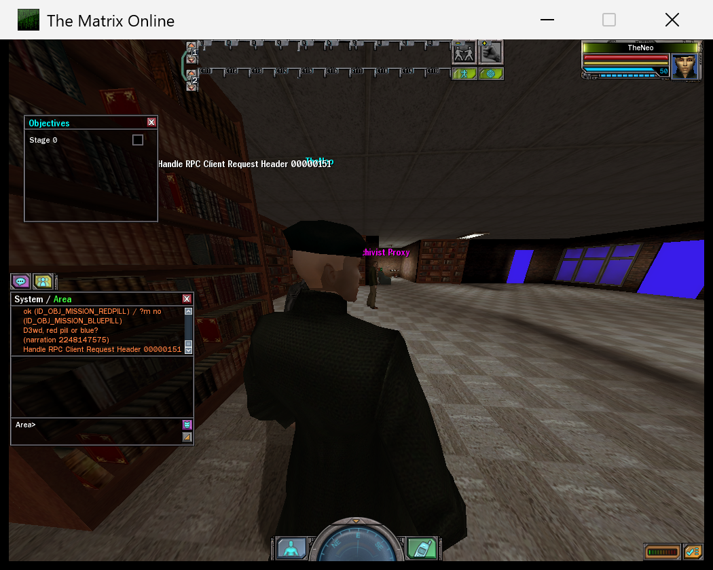
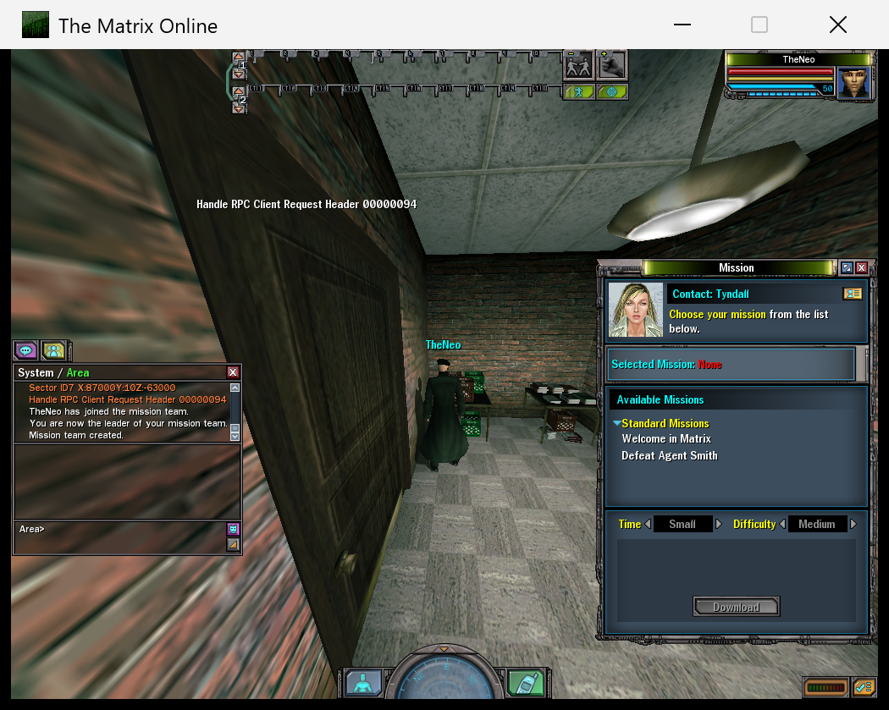
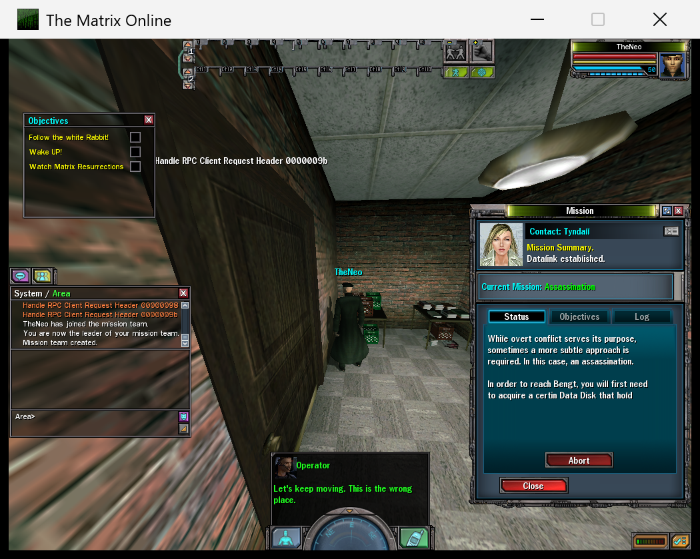
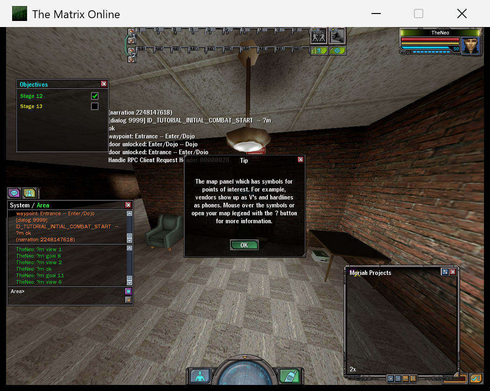

# The Matrix Online — Static Recompilation

A static recompilation of **The Matrix Online** client (Monolith / SOE, 2005) from
its Win32 `client.dll` to native C, plus a companion server that runs the game's
own rule and mission scripts. The client is lifted with the
[pcrecomp](https://github.com/sp00nznet/pcrecomp) toolchain; the server is a fork
of [mxo-hd](https://github.com/hdneo/mxo-hd) at
[sp00nznet/mxo-hd-recomp](https://github.com/sp00nznet/mxo-hd-recomp).

The official servers closed in 2009. The emulators that followed were built from
packet captures, which recover the wire format but not the rules behind it. This
project reads the rules out of the client instead: combat, abilities and
missions ship inside it as Python bytecode, and the recompiled client is the
reference for everything else.

> **No game files or generated code are in this repo.** You supply your own copy
> of the game; the lifter generates the C locally into git-ignored directories.

## Status: alpha — in the world, missions play

| Milestone | State |
|---|---|
| Lift `client.dll` (final client, 89,340 functions) | ✅ 0 errors |
| Lift `launcher.exe` (login TCP engine, 6,202 functions) | ✅ 0 errors |
| Build and link the host (MSVC 2022, x86) | ✅ |
| `InitClientDLL`, window, Direct3D 9, DirectInput, audio, Bink | ✅ |
| Game Python (`pythonMXO.dll`) | ✅ runs natively |
| Log in against the server fork (RSA, Twofish, MD5 key) | ✅ |
| Character select, world load (Mega City), HUD | ✅ |
| Chat, walking, camera, targeting | ✅ |
| Mission UI: contacts, list, accept, objectives, Operator dialogue | ✅ |
| The game's own scripted missions (tutorial 185, new-player 986) | ✅ both play to completion |
| Mission goals completed by real client actions | 🟡 movement, camera, targeting, object use, inventory, combat, loot; dialog replies and panel events are still chat stand-ins |
| Combat rules from the client's Python | ⬜ read and documented ([COMBAT](docs/COMBAT.md)), not yet serving |
| Procedurally generated missions | ⬜ the generator was server-side and is lost |
| Retail 1.0 client (2005 discs) | 🟡 lifts and builds; not re-run since the final-client fixes |

Lifting and running are not the same as correct: the host still masks SSE in
CPUID, and a handful of 3DNow! paths never run on modern CPUs.

## Screenshots

| | |
|---|---|
|  |  |
| In Mega City, with the tutorial's objective tracker | Calling a contact from the phone |
|  |  |
| A mission accepted, with Operator dialogue | The tutorial's own script ticking off objectives |

## Getting started

There is no one-click setup yet. This is the developer route.

### What you need

- Windows 10 or 11 (the host is a 32-bit Win32 program).
- **Your own copy of the final client**, `MxO_7.6005` (2,666 files). The 2005 retail discs also work for the lift, but the server targets the final client.
- Visual Studio 2022 **Build Tools** with the C++ x86 toolset.
- Python 3.11+ (`py` launcher), with `pip install capstone pefile xdis uncompyle6`.
- The [pcrecomp](https://github.com/sp00nznet/pcrecomp) toolbox, checked out next to this repo as `../tools`.
- IDA Pro 9.1 with idalib (optional but recommended: it supplies the function catalog; `disasm32` alone finds most functions but takes about 40 minutes and 2.4 GB).
- For the server: the .NET 8 SDK, Docker (MySQL), and the [server fork](https://github.com/sp00nznet/mxo-hd-recomp) checked out next to this repo as `../mxo-hd-recomp`.

### Steps

1. **Put the game in place.** Extract the client into `game_final/`. It is git-ignored.
2. **Build the function catalog** (writes `analysis/final_*.json`, git-ignored). The
   toolbox scripts are in `../tools/tools`; the IDA ones need idalib activated under `py -3.11`:
   ```
   python ../tools/tools/pe/pe_analyze.py game_final/client.dll --json analysis/final_client_pe.json
   python ../tools/tools/disasm/disasm32.py game_final/client.dll -o analysis/final_functions.json
   py -3.11 ../tools/tools/ida/ida_funcs.py game_final/client.dll analysis/final_ida_funcs.json
   py -3.11 ../tools/tools/ida/ida_xrefs.py game_final/client.dll analysis/final_ida_xrefs.json
   python tools/ida_to_catalog.py --dll game_final/client.dll --funcs analysis/final_ida_funcs.json \
       --xrefs analysis/final_ida_xrefs.json --pe analysis/final_client_pe.json \
       --augment analysis/final_functions.json -o analysis/final_functions_ida.json
   ```
3. **Lift** (about a minute; writes `src/recomp/gen_final/`, git-ignored):
   ```
   python run_lift.py --dll game_final/client.dll --catalog analysis/final_functions_ida.json \
       --out src/recomp/gen_final --seeds analysis/final_missing_targets.json --all --split 500
   python gen_imports.py --dll game_final/client.dll -o src/runtime/imports_gen_final.c
   ```
   Copy `imports_gen_final.c` to `src/runtime/_imports_active.c`.
4. **Build the host** (about 10 minutes): `tools\build.bat final` → `build/mxo_final.exe`.
5. **Start the server**: see the fork's README. In short: `docker start mxo-db`, then run
   `hds.exe` with `MXO_PUBKEY_HASH=MD5`.
6. **Run the client** from the game directory:
   ```
   cd game_final
   set MXO_LOGIN=loluser:lolpass
   ..\build\mxo_final.exe client.dll --boot
   ```
   Expected: the window opens, logs in, and loads Mega City in about 20 seconds.

[docs/running.md](docs/running.md) covers the session scripts, environment variables and diagnostics.

## Usage

```
sh tools/play.sh 600          # fresh server + client, waits until in the world
sh tools/mission.sh 3         # accept Tyndall's 3rd mission (the tutorial, Mission185)
sh tools/say.sh "?m status"   # type a chat line; ?m commands talk to the mission host
powershell -File tools/screenshot.ps1 work/shot.png
```

[docs/missions.md](docs/missions.md) explains how the game's mission scripts run on the server.

## Documentation

| Doc | What's in it |
|---|---|
| [running.md](docs/running.md) | Session scripts, environment variables, diagnostic modes |
| [HOST.md](docs/HOST.md) | How the host runs the lifted client: imports, native passthrough, threads, DEP entry |
| [missions.md](docs/missions.md) | Scripted missions: the 21 verbs, 12 callbacks, what is wired |
| [RECON.md](docs/RECON.md) | What the client contains: Python archives, the mission system, engine subsystems |
| [COMBAT.md](docs/COMBAT.md) | The combat rules as read from the client's Python |
| [SERVERS.md](docs/SERVERS.md) | Prior emulators, their licences, and what may be used |
| [CLIENT-SOURCES.md](docs/CLIENT-SOURCES.md) | Which client builds exist and which one is targeted |
| [ROADMAP.md](ROADMAP.md) | Where the project is going |
| [devlog.md](docs/devlog.md) | The full development diary, including findings later corrected |

## Building from source

The build is steps 2–4 above. After editing runtime files only, rebuild just those:
`tools\build.bat final src\runtime\host.c`. A traced build with a call-entry ring and
`--firsthit`/`--calltrace` diagnostics: `tools\build.bat final trace`. After any toolbox
change, re-lift, copy the toolbox's `recomp_types.h` into `src/runtime`, and rebuild in full.

## License

MIT, see [LICENSE](LICENSE). This covers the tools and runtime in this repo only.
The Matrix Online and its files belong to their owners; nothing from the game,
and no code generated from it, is distributed here.
